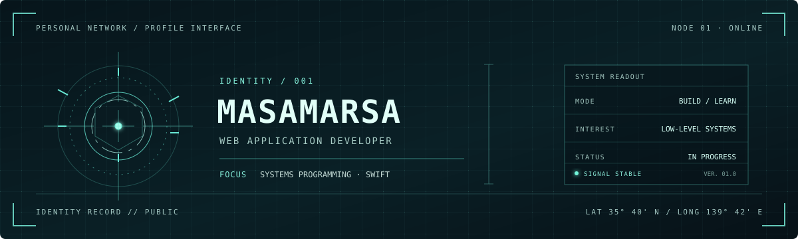

### MASAMARSA // PERSONAL NODE
`WEB APPLICATION DEVELOPER` &nbsp;·&nbsp; `SYSTEMS PROGRAMMING` &nbsp;·&nbsp; `LEARNING SWIFT`

---

### PROFILE

| CURRENT FOCUS | INTERESTS |
|:--|:--|
| Web application development | Systems programming |
| Learning Swift | Developer tools & open source |

### TOOLKIT

**Daily drivers**

**Occasional contact**

### GITHUB TELEMETRY

